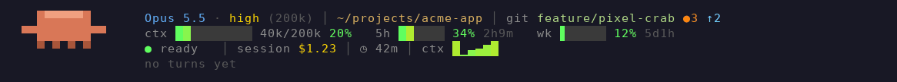

# claude-mods

Personal Claude Code mods, set up as a plugin marketplace.

## pixelbar

An animated pixel-art status band above the prompt, with a pixel crab that reacts to what Claude is doing.



Model and effort, path and git, context / 5h / weekly bars, session and turn cost, a context sparkline, a test/build badge, a turn summary, a 5h pace warning, an uncommitted-work nudge, a session files pane and a focus timer. See the [pixelbar README](pixelbar/README.md) for details and commands.

## todo

A `TODO.md` task board (Todo / Doing / Done) with a panel beside the transcript: capture tasks in one line, let Claude enrich them with IDs and context, and keep a log of what was done. See the [todo README](todo/README.md).

## pi

Long-lived [pi](https://github.com/earendil-works/pi) coding-agent sessions run from Claude Code inside its Bash sandbox, so pi only sees a masked provider key: a session runner Claude drives, a panel listing the sessions, a guard keeping Claude's file tools out of `~/.pi`, and a check of the sandbox settings that do the masking. For now it works only with an opencode-go API key, and it needs a one-time sandbox setup before pi will start: see the [pi README](pi/README.md).

## Install

```bash
claude plugin marketplace add elkinaguas/claude-mods
claude plugin install pixelbar@claude-mods
claude plugin install todo@claude-mods
claude plugin install pi@claude-mods
```

To update later:

```bash
claude plugin marketplace update claude-mods
claude plugin update pixelbar@claude-mods
claude plugin update todo@claude-mods
claude plugin update pi@claude-mods
```

When the marketplace is added from a local clone instead (`claude plugin marketplace add /path/to/claude-mods`), the plugin is read straight from that folder: after editing, run `/reload-plugins` in a session.

## Develop

```bash
claude plugin validate pixelbar
claude plugin test pixelbar
claude plugin validate todo
claude plugin test todo
claude plugin validate pi
claude plugin test pi
node --test 'pi/tests/*.test.mjs'
tools/pixelbar-demo/make-gif.sh   # rebuild pixelbar/demo.gif
```
